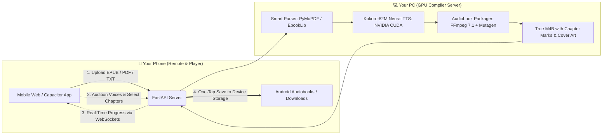

# ⚡ BookForge — Book to Audiobook GPU Compiler 📖🔊

<p align="center">
  
  
  
  
  
</p>

> **Transform your books (EPUB, PDF, TXT) into professional neural audiobooks using your PC's desktop GPU, and save them directly onto your phone.**  
> Powered by **Kokoro-82M (CUDA)**, **FastAPI**, and **Capacitor**. Zero cloud subscription fees, 100% private.

---

## 💡 The Architecture Shift

Running heavy neural speech models on a mobile device drains battery, causes thermal throttling, and limits audio quality.  
**BookForge decouples synthesis from playback:**



---

## 🌟 Highlights & Features

- **⚡ Blazing Fast GPU Synthesis**: Powered by PyTorch CUDA on your desktop GPU (`~0.39s` per sentence once warm, 15–25× real-time factor).
- **🎙️ 30+ Expressive Neural Voices**: Select from top-tier studio voices across American and British accents with instant 3-second preview audition buttons.
- **📄 Smart Multi-Format Document Ingestion**:
  - **EPUB**: Automatically extracts spine documents, chapter headers, metadata, and embedded cover art. Features a zipfile fallback for malformed/Calibre EPUBs.
  - **PDF**: Uses PyMuPDF (`fitz`) for sub-second bookmark navigation, clean header/footer stripping, and page-zero cover rendering.
  - **TXT / Markdown**: Automatic regex chapter header detection.
- **🎧 True M4B Audiobooks with Chapters**: Generates industry-standard `.m4b` files with embedded chapter markers (compatible with Smart AudioBook Player, Voice, Sirin, Apple Books, and VLC).
- **📱 Zero-Config Wi-Fi Pairing**: The PC server automatically detects your local Wi-Fi IP and prints an interactive ASCII QR code right in your terminal. Scan with your phone camera to connect instantly.
- **📲 Ready-to-Install Android App**: Includes full Capacitor source and a pre-compiled, lightweight [**`BookForge.apk`**](BookForge.apk) (3.9 MB).
- **🎶 Built-in Offline Web Player**: Integrated audio player supporting Android lockscreen playback controls (MediaSession API).

---

## 🎙️ Voice Catalog Preview

| Voice ID | Name | Gender | Accent | Tone & Style |
| :--- | :--- | :--- | :--- | :--- |
| `af_heart` | **Heart** | Female | American | Warm, emotional & expressive *(Kokoro Flagship)* |
| `am_michael` | **Michael** | Male | American | Deep, rich audiobook narrator |
| `bf_alice` | **Alice** | Female | British | Sophisticated, refined narrative |
| `bm_george` | **George** | Male | British | Classic literary storyteller |
| `af_bella` | **Bella** | Female | American | Clear, friendly & natural tone |
| `am_adam` | **Adam** | Male | American | Confident, clear & steady |
| `bf_emma` | **Emma** | Female | British | Warm, expressive classic British |
| `bm_fable` | **Fable** | Male | British | Poetic, dramatic delivery |

---

## 🚀 Quick Start (PC Compiler Server)

### Prerequisites
- Windows 10/11 (or Linux) with **Python 3.9+**
- NVIDIA GPU with CUDA support (or CPU fallback)

### 1. Clone & Install
```bash
git clone https://github.com/yabets4/bookforge.git
cd bookforge
pip install -r requirements.txt
```

### 2. Launch the Compiler Server
```bash
python run.py
```
*(Or simply double-click [`run.bat`](run.bat))*

Your terminal will print the connection address and a terminal QR code:
```
============================================================
  ⚡ BookForge — Book to Audiobook GPU Compiler 📖🔊
============================================================
  • PC Browser:     http://localhost:8000
  • Phone Browser:  http://192.168.240.131:8000
============================================================
  📱 SCAN WITH YOUR PHONE TO OPEN INSTANTLY:
  [QR CODE]
```

---

## 📱 Mobile App (Android)

### Option 1: Install Pre-Built APK (Recommended)
1. Download [**`BookForge.apk`**](BookForge.apk) directly onto your Android device.
2. Open the file to sideload and install.
3. Launch BookForge and connect to your PC's IP.

### Option 2: Mobile Browser / PWA (Zero Installation)
1. Connect your phone to the same Wi-Fi network as your PC.
2. Scan the terminal QR code or open `http://<your-pc-ip>:8000` in Chrome/Safari.
3. *(Optional)* Tap **"Add to Home Screen"** to install as a standalone PWA.

---

## 🛠️ Performance & Hardware Benchmarks

| Metric | Measurement (NVIDIA GTX 860M / 2GB VRAM) |
| :--- | :--- |
| **Model Size** | 82M Parameters (~326 MB) |
| **VRAM Footprint** | ~750 MB VRAM (Fits easily on 2GB+ GPUs) |
| **Inference Speed** | **~0.39s per sentence** (24,000 Hz audio) |
| **Real-Time Factor (RTF)** | **~15× to 22× real-time** |
| **Audio Output** | AAC 64 kbps (Mono/Stereo optimized for speech) |
| **File Footprint** | ~28 MB per 1 hour of narrated audiobook |

---

## 🧪 Testing

BookForge includes automated unit and integration tests:

```bash
# Run multi-format parser tests (EPUB, PDF, TXT)
python test_parser.py

# Run M4B muxing, chapter tagging & MP3 packaging tests
python test_packager.py

# Run full async pipeline integration tests
python test_integration.py
```

---

## 📄 License

This project is licensed under the [MIT License](LICENSE).
